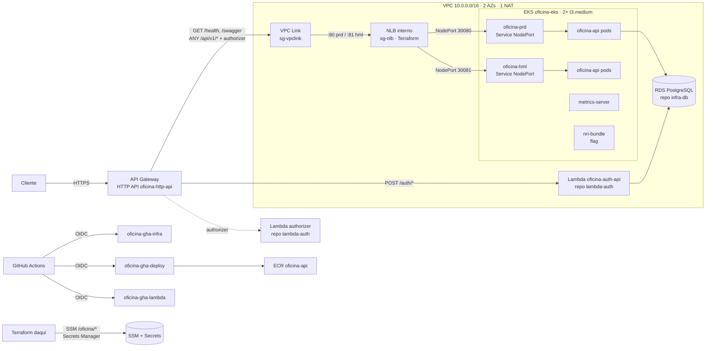

# Oficina Mecânica — Plataforma Kubernetes e borda HTTP (`oficina-infra-k8s`)

> **Tech Challenge — Fase 3 — Pós-Tech FIAP (15SOAT)**

Terraform da infraestrutura compartilhada da Fase 3: **VPC**, **EKS** (1 cluster, namespaces
`oficina-hml` e `oficina-prd`), **ECR**, **roles OIDC** do GitHub Actions, **NLB interno**
gerenciado pelo Terraform, **VPC Link**, **API Gateway HTTP API**, segredos compartilhados,
`metrics-server` e **New Relic** (Helm + dashboards/alertas como código, atrás de flag).

## Repositórios relacionados

| Repositório | Responsabilidade |
|---|---|
| [`oficina-app`](https://github.com/lcr-thiago-fernandes/oficina-app) | API .NET 8 em Kubernetes; documentação arquitetural central (`docs/`) |
| [`oficina-lambda-auth`](https://github.com/lcr-thiago-fernandes/oficina-lambda-auth) | Autenticação serverless (emissor único de JWT) e Lambda Authorizer |
| `oficina-infra-k8s` (este) | VPC, EKS, ECR, NLB interno, API Gateway, VPC Link, New Relic |
| `oficina-infra-db` | RDS PostgreSQL 16 |

Contratos: [`docs/contratos.md`](docs/contratos.md) e
[`oficina-app/docs/contratos-entre-repositorios.md`](https://github.com/lcr-thiago-fernandes/oficina-app/blob/develop/docs/contratos-entre-repositorios.md).

## Arquitetura



**Por que o Terraform é dono do NLB (ADR-016):** o VPC Link precisa do ARN do listener no
`apply`; um `Service LoadBalancer` só o teria depois do deploy da aplicação. Por isso o
Service do `oficina-app` é `NodePort` e o Terraform anexa o ASG do node group a um target
group por porta.

## Recursos

| Arquivo | O que cria |
|---|---|
| `terraform/vpc.tf` | VPC 2 AZs, subnets públicas/privadas, 1 NAT (por onde a auth-api sai para Secrets Manager e DynamoDB) |
| `terraform/eks.tf` | EKS `1.33`, node group `t3.medium` (2/1/3), addons, access entries para `gha-infra`, `gha-deploy` e `cluster_admin_principal_arns` |
| `terraform/ecr.tf` | `oficina-api`, scan on push, mantém 10 imagens |
| `terraform/iam-oidc.tf` | roles `oficina-gha-deploy` e `oficina-gha-lambda` (trust por branch, policies escopadas por nome) |
| `terraform/nlb.tf` | SGs `vpclink`/`nlb`, NLB interno, target groups 30080/30081 (`/health`), listeners 80/81, `aws_autoscaling_attachment` |
| `terraform/apigw.tf` | HTTP API, stage `$default` (access logs, teto global, throttling de `/auth/*` atrás de flag), VPC Link, 2 integrações HTTP_PROXY (pública e com mapeamento de contexto), 3 rotas sem authorizer (`GET /health`, `GET /swagger`, `GET /swagger/{proxy+}`) |
| `terraform/secrets.tf` | `oficina/jwt_secret`, `oficina/newrelic_license_key` (texto puro) |
| `terraform/helm.tf` | `metrics-server` (HPA) e `nri-bundle` (flag `newrelic_habilitado`) |
| `terraform/ssm.tf` | os 8 parâmetros do contrato da Fase 3 + 6 da Fase 4 |
| `terraform/alarmes-dlq.tf` | Fase 4: tópico SNS `oficina-alertas-dlq` e 3 alarmes CloudWatch das filas `prd-oficina-*_error` |
| `terraform/newrelic/` | root separado: política `Oficina-Prod`, 8 condições NRQL (5 da Fase 3 + 3 da saga), dashboards "Operacao" e "Saga da OS", e-mail |
| `scripts/bootstrap.sh` | bucket + lock do tfstate, OIDC provider, role `oficina-gha-infra` (trust para os repositórios de `REPOS_INFRA`) |

## Ordem de provisionamento da Fase 3

```
1. scripts/bootstrap.sh          (local, uma vez)
2. oficina-infra-k8s  (este)     → publica SSM /oficina/network|apigw|eks|ecr, cria roles e segredos
3. oficina-infra-db              → RDS; /oficina/db/*; oficina/db_password
4. oficina-lambda-auth           → /auth/*, authorizer, ANY /api/v1/{proxy+}
5. oficina-app                   → imagem no ECR + kubectl apply (hml/prd)
6. (volta aqui) THROTTLING_AUTH_HABILITADO=true + re-executar o CD   ← decisão D1
```

`terraform destroy` na ordem inversa. Custo com tudo no ar: ~US$ 196/mês (EKS 73, nós 60,
NAT 32, RDS 15, NLB 16); destrua fora das janelas de demonstração.

## Bootstrap (uma vez)

```bash
export PATH="/c/Program Files/Amazon/AWSCLIV2:$PATH"   # Git Bash no Windows
aws configure   # credenciais de administrador da conta
./scripts/bootstrap.sh
```
O script imprime o ARN de `oficina-gha-infra`. Defina-o como secret `AWS_TERRAFORM_ROLE_ARN`
em cada repositório de `REPOS_INFRA` (Fase 4: também `oficina-app`, `oficina-billing-service` e
`oficina-execucao-service` — ver seção [Fase 4](#fase-4)).

## Deploy

| Branch | Ação do CD |
|---|---|
| `develop` | `terraform plan` |
| `main` | `terraform apply` (+ `terraform/newrelic` se `NEW_RELIC_HABILITADO=true`) |

Secrets do GitHub: `AWS_TERRAFORM_ROLE_ARN`, `JWT_SECRET` (≥ 32 chars), `NEW_RELIC_LICENSE_KEY`,
`NEW_RELIC_ACCOUNT_ID`, `NEW_RELIC_API_KEY`.
Variables: `AWS_REGION=us-east-1`, `NEW_RELIC_HABILITADO=false`, `THROTTLING_AUTH_HABILITADO=false`,
`NEW_RELIC_EMAIL_ALERTAS`, `CLUSTER_ADMIN_ARNS` (lista JSON de ARNs com admin no cluster; default `[]`).

Depois do `apply`, o job imprime `gha_deploy_role_arn` e `gha_lambda_role_arn`: eles viram
`AWS_DEPLOY_ROLE_ARN` no `oficina-app` e `AWS_LAMBDA_ROLE_ARN` no `oficina-lambda-auth`.

Manual, da máquina (a sua identidade precisa estar em `cluster_admin_principal_arns`):
```bash
export TF_VAR_jwt_secret='...32+ caracteres...'
terraform -chdir=terraform init
terraform -chdir=terraform apply -var-file=local.tfvars    # copie de exemplo.tfvars
aws eks update-kubeconfig --region us-east-1 --name oficina-eks
```
Quem aplica localmente deve usar a mesma lista de `CLUSTER_ADMIN_ARNS` em `cluster_admin_principal_arns`, senão o próximo apply do CD remove a access entry.

Homologação (`oficina-hml`, NodePort 30081) não passa pelo API Gateway: teste de dentro da
VPC (`kubectl -n oficina-hml port-forward svc/oficina-api 8081:80` ou `curl http://<nlb_dns_name>:81/health`
a partir de um pod).

## Observabilidade

- `metrics-server` sempre; `nri-bundle` (infra, kube-state-metrics, eventos, logs de sistema)
  quando `newrelic_habilitado = true`. O Fluent Bit **exclui** os namespaces `oficina-*`: os logs
  da aplicação já chegam pelo agente APM (logs in context), senão duplicam.
- `terraform/newrelic/`: `Oficina-API-Prod-Latencia-Critical`, `Oficina-API-Prod-TaxaErro-Critical`,
  `Oficina-API-Prod-Uptime-Critical`, `Oficina-OS-Prod-FalhaProcessamento-Critical`,
  `Oficina-EKS-Prod-CPU-Warning`; dashboard "Oficina Mecanica - Operacao" (6 widgets);
  notificação por e-mail. Runbooks em [`docs/runbooks.md`](docs/runbooks.md).

## Fase 4

A Fase 4 (saga orquestrada entre OS Service, Billing e Execução — design em
`oficina-app/docs/arquitetura/fase4-design-arquitetural.md`, seções 3, 6.4 e 9) mantém este
repositório como dono da plataforma compartilhada. Os serviços novos criam o **próprio**
`terraform/` (ECR, DynamoDB, IRSA, role de deploy, target group + listener no NLB, rotas no
API Gateway) lendo do SSM os parâmetros abaixo — nunca `terraform_remote_state`.

### Parâmetros SSM novos (contrato)

| Parâmetro | Tipo | Valor | Quem lê |
|---|---|---|---|
| `/oficina/eks/oidc_provider_arn` | String | `module.eks.oidc_provider_arn` | `Federated` da trust IRSA: oficina-app, billing, execução |
| `/oficina/eks/oidc_provider_url` | String | `module.eks.oidc_provider` — issuer **sem** `https://` | chaves `<url>:sub`/`<url>:aud` da trust IRSA: oficina-app, billing, execução |
| `/oficina/nlb/arn` | String | `aws_lb.interno.arn` | listeners próprios (billing 8081/8082, execução 8083/8084) |
| `/oficina/nlb/security_group_id` | String | `aws_security_group.nlb.id` | regras de SG das portas de cada serviço |
| `/oficina/apigw/vpc_link_security_group_id` | String | `aws_security_group.vpclink.id` | egress do VPC Link para o listener prd de cada serviço |
| `/oficina/eks/node_asg_names` | **StringList** | `join(",", module.eks.eks_managed_node_groups_autoscaling_group_names)` | `aws_autoscaling_attachment` (ASG × ambiente) de billing e execução |

O ID do Lambda Authorizer continua em `/oficina/auth/lambda_authorizer_id` (publicado pelo
`oficina-lambda-auth`). O `scripts/verificar-contratos.sh` (job `contratos` do CI) confere os
nomes, o `StringList`, a origem sem `https://`, a leitura de `/oficina/os-service/*` e o `REPOS_INFRA`.

### Outras mudanças

- **`REPOS_INFRA`** (`scripts/bootstrap.sh`) passa a ser `oficina-infra-k8s`, `oficina-infra-db`,
  `oficina-app`, `oficina-billing-service`, `oficina-execucao-service`: o `infra.yml` de cada
  serviço assume `oficina-gha-infra` (secret `AWS_TERRAFORM_ROLE_ARN`) para aplicar o próprio
  `terraform/`. A trust aceita só `ref:refs/heads/main` e `ref:refs/heads/develop` (os
  `infra.yml` fazem `plan` em push e `apply` via `workflow_dispatch` só nessas branches, sem
  `environment:` — que mudaria o `sub` do token); em PR rodam apenas `fmt`/`validate`, sem AWS.
  **Re-execute `./scripts/bootstrap.sh`** para atualizar a trust da role existente.
  Limitação: a role é `AdministratorAccess` (já registrada na Fase 3); agora cinco repositórios a assumem.
- **Role `oficina-gha-deploy`** (CD do `oficina-app`): `ssm:GetParameter(s)` também em
  `/oficina/os-service/*` (o `cd.yml` lê `/oficina/os-service/<amb>/irsa_role_arn`, com `<amb>` = `prd` ou `hml`).
- **API Gateway:** removida a rota pública `POST /api/v1/ordens-servico/{id}/orcamento/aprovacao`
  (o webhook agora é `POST /billing/webhooks/mercadopago`, criado pelo `oficina-billing-service`).
  A integração `vpc_link_publica` continua (usada por `/health` e `/swagger`).
- **New Relic** (`terraform/newrelic/`): dashboard **"Oficina Mecanica - Saga da OS"** (sagas
  por estado atual da saga — `Entregue` não aparece: a entrega fica fora da saga, que termina em
  `Concluida` —, passos por resultado, sagas compensadas por motivo (`uniqueCount(ordemServicoId)`),
  tempo por passo em segundos, duração da execução da fila à finalização (soma de `duracaoMs`; o
  `duracaoMinutos` do `ExecucaoEvento` é inteiro e daria 0 numa demo), pagamentos por
  etapa/resultado, execuções por status, throughput por serviço via `Transaction` por `appName`,
  nota de trace distribuído por `ordemServicoId` e mapa de serviços) e três condições na política
  `Oficina-Prod`:
  - `Oficina-Saga-Prod-Compensacao-Warning`: `uniqueCount(ordemServicoId)` só do **início** da
    compensação (`compensacao IS true AND (resultado = 'Falha' OR passo = 'Cancelamento')`); o
    desfecho (`Compensado`/`CompensacaoFalhou`) não conta, então um fluxo de estorno gera um sinal
    e não duplica o Critical.
  - `Oficina-Saga-Prod-CompensacaoFalhou-Critical` e `Oficina-Billing-Prod-EstornoFalhou-Critical`:
    mantidos separados. **Uma falha de estorno pedido pela saga abre 2 incidentes** (saga +
    Billing), o que é esperado; o do Billing cobre também o `EstornoAutomatico`, que não passa pela saga.

  Runbooks em [`docs/runbooks.md`](docs/runbooks.md).
- **Fila DLQ com mensagens** (`terraform/alarmes-dlq.tf`): alarmes **CloudWatch**
  `Oficina-Saga-Prod-DLQ-{os_saga,billing_comandos,execucao_comandos}-Critical` sobre
  `AWS/SQS ApproximateNumberOfMessagesVisible` (dimensão `QueueName`) das filas
  `prd-oficina-os-saga_error`, `prd-oficina-billing-comandos_error` e
  `prd-oficina-execucao-comandos_error`, notificando o tópico SNS `oficina-alertas-dlq`
  (e-mail de `NEW_RELIC_EMAIL_ALERTAS`; a inscrição precisa ser confirmada). **Por que não New
  Relic:** a conta não tem a integração AWS (link de conta + polling SQS) configurada aqui;
  nenhum serviço emite evento quando a mensagem vai para a `_error` (`PublishFaults = false`);
  e o Fluent Bit exclui os namespaces `oficina-*`, então não há log para consultar. Ligar a
  integração AWS do New Relic depois permite trocar estes alarmes por NRQL sobre `QueueSample`.

### Ordem de aplicação (Fase 4)

```
1. scripts/bootstrap.sh                  (re-executar: trust de oficina-gha-infra com os 5 repositórios)
2. oficina-infra-k8s  (este)             → SSM novos, deploy role com /oficina/os-service/*, alarmes DLQ
3. oficina-infra-db                      → inalterado
4. oficina-lambda-auth                   → inalterado; publica /oficina/auth/lambda_authorizer_id
5. oficina-app        (terraform/)       → IRSA do OS Service, /oficina/os-service/<amb>/irsa_role_arn; depois o CD
6. oficina-billing-service (terraform/)  → ECR, DynamoDB, IRSA, NLB 8081/8082, rotas /billing/*; depois o CD
7. oficina-execucao-service (terraform/) → ECR, DynamoDB, IRSA, NLB 8083/8084, rotas /execucao/*; depois o CD
```

Destruição na ordem inversa (listeners/target groups dos serviços saem antes do NLB).

### Verificação semântica da observabilidade

Cada atributo e valor usado nas NRQL foi conferido no código dos produtores (lição da Fase 3):

| Evento | Atributos usados | Fonte |
|---|---|---|
| `SagaOrdemServico` | `ordemServicoId`, `passo`, `resultado`, `compensacao`, `duracaoMs`, `estado`, `motivo` | `PublicadorEventoSagaNewRelic` + valores de `PassosSaga` (`Falha`, `Compensado`, `CompensacaoFalhou`, passo `Cancelamento`) e estados de `OrdemServicoSaga` no `oficina-app` |
| `PagamentoEvento` | `etapa` (`EstornoFalhou`, `EstornoAutomatico`), `resultado` (`Sucesso`/`Falha`) | `oficina-billing-service`: `TelemetriaPagamentoNewRelic` e casos de uso |
| `ExecucaoEvento` | `statusNovo` (`Finalizada`…), `resultado`, `duracaoMinutos` | `oficina-execucao-service`: `TelemetriaExecucaoNewRelic`, `StatusExecucao` |
| `Transaction` | `appName` ∈ `oficina-api`, `oficina-billing`, `oficina-execucao` | `NEW_RELIC_APP_NAME` em `k8s/deployment.yaml` de cada serviço |

`SagaOrdemServico` traz também `motivo` (razão de negócio, presente em `compensacao = true`,
`Falha` e `CompensacaoFalhou`) e `detalhe` (`PagamentoId` ou nome do `StatusExecucao`), conforme o
`PublicadorEventoSagaNewRelic` do `oficina-app`.

> **Verificar após o primeiro deploy:** `SELECT count(*) FROM SagaOrdemServico FACET compensacao SINCE 1 day ago`
> precisa mostrar `true`/`false` **booleanos**. Se o agente os enviar como string, `compensacao IS true`
> não casa nada e o dashboard/alerta de compensação ficam mudos — nesse caso, trocar por
> `compensacao = 'true'`.

## Decisões e limitações registradas

1. **Throttling de `/auth/*` em duas passadas** (D1): `route_settings` exige rota existente; as
   rotas nascem no `lambda-auth`. Flag `throttling_auth_habilitado`.
2. **`oficina/newrelic_license_key` sempre existe** (D2), com placeholder quando desligado — o
   CD do `oficina-app` exige o segredo.
3. **hml só dentro da VPC** (D3): um único HTTP API, apontando para prd.
4. **NLB com SG próprio e `preserve_client_ip = false`** (D4): regras por referência de SG,
   health checks cobertos; IP do cliente em `X-Forwarded-For`.
5. **`GET /swagger` além de `/swagger/{proxy+}`** (D5).
6. **`oficina-gha-infra` com `AdministratorAccess`, criada fora do Terraform** (D6): o módulo
   EKS toca IAM, KMS, logs, launch templates; enumerar ações é frágil.
7. **`oficina-gha-lambda` mais ampla que o design, escopada por nome** (D7).
8. **Access entries determinísticas** (D8): quem aplica da máquina põe o próprio ARN em
   `cluster_admin_principal_arns`, senão o `helm_release` falha com `Unauthorized`.
9. **New Relic em root separado** (D9): o provider exige credenciais na configuração.
10. **Sem `plan` em PR** (D10): trust por branch não cobre `pull_request`.
11. **Providers em aws 5.x / eks 20.x / vpc 5.x / helm 2.x** (D11); Dependabot ignora majors.
12. **`use_lockfile` + `dynamodb_table`** no backend (D12); Terraform ≥ 1.10.
13. **`jwt_secret` no state** (D13): bucket criptografado, versionado, sem acesso público.
14. **Nada foi aplicado ainda**: `terraform validate` verde nos dois roots; o primeiro `apply`
    real pode revelar ajustes (versão do EKS disponível, nomes de inputs do módulo, schema do
    provider New Relic). Conferir `aws eks describe-cluster-versions` antes.
15. **Endpoint público do EKS** (`cluster_endpoint_public_access = true`, CIDR aberto) é a única
    superfície fora do API Gateway: necessário para o `kubectl` do CD e da máquina. Autenticação
    por IAM/access entries continua obrigatória; endpoint privado exigiria um runner dentro da
    VPC (custo). Os nós ficam em subnets privadas.

## Swagger

`GET https://<api_endpoint>/swagger` (produção) depois do deploy do `oficina-app`.

## Licença

Uso acadêmico — FIAP Pós-Tech 15SOAT.
